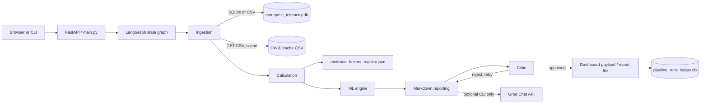

# CarbonTrace — Complete Technical Audit and Handover

**Audit date:** 2026-11-17  
**Project directory audited:** `carbon_trace-main/`  
**Declared application version:** `4.0.0` (`VERSION`, FastAPI metadata)  
**Assessment:** Student capstone / functional prototype; not production-ready  
**Scope:** Read-only source/configuration audit plus creation of this requested document. No application files were changed.

## 1. Executive summary

CarbonTrace is a Python application that estimates an organization's emissions for a limited set of activities, compares the resulting time series with country-level CO2 from Our World in Data (OWID), performs exploratory forecasting/anomaly analysis, and produces a Markdown report. A LangGraph graph coordinates five Python functions. A FastAPI server exposes the pipeline and serves a hand-written HTML/CSS/JavaScript dashboard.

The code contains meaningful prototype functionality: activity validation and aggregation, deterministic emission-factor arithmetic, SQLite seeding and run history, BRSR text/PDF parsing, a walk-forward Ridge model, report generation, and tests for selected paths. The actual checked-out copy cannot currently import its backend in this environment because `pdfplumber` (listed in `requirements.txt`) is not installed. No `data/` directory, SQLite database, factor registry, OWID cache, or sample PDF fixtures were present. Consequently, a live end-to-end run, live OWID download, OCR, and actual BRSR filing accuracy were not verified.

The most important product correctness issue is that generated activity rows for listed companies are marked `VERIFIED_BRSR_FILING`, even though the activity values are scaled from a synthetic fixed series. Registry/BRSR values are also embedded in Python constants and UI fallbacks. Users can therefore see fabricated or approximate values presented with regulatory/verification styling. This must be corrected before any operational use.

Other material gaps include no authentication/authorization, unsafe HTML insertion of PDF-derived values, a PDF endpoint that reads an unbounded request body, an undeclared OCR renderer dependency, incomplete UI-to-API parameter passing, and an incomplete reproducible test setup. No real MCA, BSE, or NSE integration exists; those claims are represented by a local hard-coded registry.

## 2. Problem statement, purpose, and users

### Problem addressed

Operational emissions data are usually distributed among fuel, electricity, travel, and freight records. CarbonTrace demonstrates a repeatable workflow to:

1. Load activity records for an organization and aggregate facilities by organization/year.
2. Convert selected activity units into estimated Scope 1, 2, and 3 tCO2e using a JSON factor registry.
3. compare those estimates with national CO2 data from OWID;
4. run exploratory trend, forecast, and anomaly algorithms;
5. optionally extract selected Principle 6 fields from a BRSR PDF; and
6. create a provenance-labelled Markdown report and dashboard payload.

### Target users implied by the implementation

- The primary target is a student, evaluator, or demonstrator of a B.Tech AI/ML capstone.
- Secondary intended users are sustainability analysts and Indian corporate reporting stakeholders exploring a limited emissions estimate.
- It is not a verified corporate accounting system, regulatory filing service, assurance engagement, or carbon-credit verification product.

### Implemented accounting boundary

- Scope 1: stationary diesel, natural gas, and a diesel fleet distance proxy.
- Scope 2: purchased electricity using a location-based grid factor selected by country.
- Scope 3: short/medium-haul business air travel and HGV road freight.
- The database has no production, refrigerant, process-emissions, commuting, purchased-goods, waste, or full value-chain inventory. The output must not be interpreted as a complete organizational inventory.
- Static 2024 factors are applied to all years. The factor registry itself documents this historical limitation.

## 3. Technology stack and why it is used

| Area | Technology | Actual use |
|---|---|---|
| Language | Python 3.10+ syntax | Pipeline, API, SQLite access, extraction, calculations, reporting, tests. Union types such as `str | None` require Python 3.10 or later; no minimum is declared in a manifest. |
| Orchestration | LangGraph `StateGraph` | Runs ingestion → calculation → ML → reporting → critic, with a reporting retry path. This is a local sequential graph, not a distributed multi-agent service. |
| API | FastAPI + Uvicorn | Serves the dashboard, health/company/run endpoints, CSV/PDF endpoints, and generated OpenAPI docs. |
| State/schema | `TypedDict`, Pydantic | LangGraph state shape and request validation. The API request schema does not cover every upload query parameter. |
| Data handling | pandas, NumPy | CSV/SQLite/OWID tabular work, aggregation, numeric calculations, and ML arrays. |
| ML | scikit-learn | StandardScaler + Ridge time-series regression, IsolationForest, KMeans, scoring metrics. |
| Storage | SQLite | Seeded activity and company-registry tables plus an independent automated-run ledger. SQLite files are created under `data/` at runtime. |
| PDF | pdfplumber, pypdf, Pillow, pytesseract; optional pypdfium2 | Digital text/table parsing and optional scanned-PDF OCR. `pypdfium2` is not declared as a dependency; Tesseract also requires a system executable. |
| Optional LLM | LangChain Groq integration, Groq SDK, python-dotenv | Optional two-sentence narrative in CLI runs only, gated by `--use-llm` and `GROQ_API_KEY`. The deterministic report remains the main path. |
| Frontend | HTML, CSS, vanilla JavaScript | Single-page dashboard served by FastAPI; no bundler, frontend package manifest, or build step. |
| Charts/Markdown | Local Plotly.js bundle and CDN-hosted Marked | Plotly renders charts; Marked converts report Markdown to HTML. Marked is loaded from an unpinned CDN URL without sanitization. |
| Fonts/icons | Google Fonts and Material Symbols CDN | Styling only; browser access depends on external network access. |
| Dev tooling | pytest, PowerShell/Bash scripts | Unit/integration tests and validators for the bundled GSD workflow/skill/template pack. |

`requirements.txt` uses lower-bound versions only; there is no lock file, `pyproject.toml`, `setup.py`, Node manifest, Dockerfile, CI configuration, or deployment manifest. Several listed packages are not used by application source (`plotly` Python package and `pdf2image`); `pypdfium2` and the PDF generator's `reportlab` are not listed.

## 4. Project directory structure

```text
carbon_trace-main/
├── .agent/workflows/                 # 27 GSD slash-workflow prompt files
├── .agents/agents/                   # 5 GSD agent prompt files
├── .agents/skills/                   # 12 GSD skill prompt files
├── .gemini/GEMINI.md                 # Gemini/GSD integration instructions
├── .gsd/examples/                    # 4 GSD process examples
├── .gsd/templates/                   # 24 GSD planning/state templates
├── adapters/                         # 3 optional model-provider guidance files
├── agents/                           # CarbonTrace Python pipeline modules
├── frontend/                         # Static dashboard and bundled Plotly.js
├── reports/                          # Static/sample Markdown reports
├── scripts/                          # GSD validators, search helpers, PDF generator
├── tests/                             # pytest suite and separate live-server script
├── .gitignore
├── CarbonTrace_Technical_Manual.pdf
├── GSD-STYLE.md
├── PROJECT_RULES.md
├── README.md
├── VERSION
├── api.py
├── main.py
├── model_capabilities.yaml
├── requirements.txt
├── seed_enterprise_db.py
├── server.py
└── state.py
```

The recursive inventory contained 121 files. There is no `.git/` directory in the supplied project path. There was also no `data/` directory at audit time; it is generated by initialization and is ignored by `.gitignore`.

## 5. File-by-file implementation notes

### 5.1 Runtime application files

| File | Responsibility and behavior | Status / interactions |
|---|---|---|
| `main.py` | Builds the LangGraph; defines the run-ledger schema/migrations; validates CLI years/interval; invokes the graph; saves an approved report; writes completed/failed run JSON to SQLite; provides CLI and infinite scheduler with three retries and exponential wait. `load_matching_persisted_run` caches by org/country/period; `load_latest_persisted_run` is currently unused. | Core implementation. Paths are relative to the process working directory. Successful CLI/API runs overwrite the same default `reports/sample_generated_report.md` path unless another path is passed. |
| `api.py` | Thin Uvicorn entry point; wildcard-imports `server` and re-exports `app`. | Functional shim; actual app is in `server.py`. |
| `server.py` | FastAPI app, static file routes, request model, dashboard response encoder, company lookup, persisted-run retrieval, synchronous run route, raw CSV/PDF request handling, temp-file cleanup, and BRSR extraction. | Implements endpoints below. No auth, rate limiting, CORS configuration, or production middleware. See security and bug sections. |
| `state.py` | `CarbonAgentState` `TypedDict`: request identity and years, CSV/PDF inputs, activity/OWID records, provenance, corporate/BRSR metadata, calculated metrics, ML output, report, critic fields, and agent logs. | Shared state contract for `main.py` and all five agents. Some dynamic keys, e.g. `uploaded_filename` and `_last_run_timestamp_utc`, are not declared in the TypedDict. |
| `seed_enterprise_db.py` | Declares static factors, demo activity series, eight listed-company registry entries, demo row generation, SQLite table creation/migration, factor JSON writing, and database seeding. | Runtime initialization writes factor JSON each time and seeds synthetic activity. Listed-company generated series inherit `VERIFIED_BRSR_FILING`; this is not evidence that the operational activity is filing-derived. |
| `agents/__init__.py` | Empty package initializer. | Required only to establish the Python package. |
| `agents/ingestion.py` | Validates CSV activity columns, organization match, numeric/nonnegative values, duplicate facility/year keys, provenance uniformity; loads/aggregates SQLite or CSV; optionally parses BRSR; obtains OWID CSV with a 24-hour cache and stale-cache fallback; returns state records and a data-quality report. | Core implementation, but it contains synthetic activity fallbacks for BRSR and relies on local registry data. External OWID network behavior was not verified. |
| `agents/calculation.py` | Reads the factor registry and calculates annual Scope 1/2/3 and total emissions; joins annual organization data with OWID on year; calculates CAGR/net change/YoY and simple z-score anomalies; returns the latest scope breakdown and factor audit. | Arithmetic covered by selected tests. Static factors and partial boundary limit accounting validity. Assumes nonempty merge after input checks. |
| `agents/ml_engine.py` | Skips series shorter than five years; fits expanding-window standardized Ridge on year and lagged emissions; compares with persistence; forecasts through at least 2030 with heuristic bands; compares Z-score/IsolationForest anomaly labels; runs KMeans scope clustering. | Implemented exploratory ML, not a production forecasting model. No ground-truth anomaly labels. The initial lag uses backfill and leaks a future value into the first training feature. |
| `agents/reporting.py` | Builds a deterministic Markdown report containing calculated metrics, boundaries, factors, BRSR reconciliation, anomalies, forecast, and recommendations; optionally calls Groq for a short narrative. | Deterministic report path implemented. LLM path is optional, CLI-only in current API wiring, unverified, and logs abbreviated errors rather than surfacing a failed run. |
| `agents/critic.py` | Checks required keyword sections and exact string appearances of selected metrics/scopes/provenance; computes a completeness percentage; approves or rejects. | Heuristic text-presence check, not independent arithmetic verification or semantic faithfulness. |
| `agents/brsr_extractor.py` | Validates CIN format; looks up local registry; extracts identity/year/provider, Principle 6, emissions/energy from tables or text; attempts scanned OCR; normalizes units; assembles disclosures; persists parsed BRSR metadata and synthetic multi-year activity. | Large parser is partially implemented. Format-only CIN validation is not authoritative. OCR renderer is optional and missing from requirements; PDF parsing was not executed because `pdfplumber` is absent. Extraction persistence is not official filing verification. |

### 5.2 API behavior and payload flow

`RunRequest` accepts `org_name` (1–120 chars), `country`, `start_year`/`end_year` (1990–2030), and optional `cin_number`. The server validates ordering on run calls. CSV/PDF routes parse integer query values manually, which can return unhandled `ValueError` responses for malformed input.

`_dashboard_payload` maps state to `ok`, organization, country/period, provenance, corporation metadata, scope values, reported values, reconciliation fields, metrics, history, forecast, anomalies, report, data quality, and agent logs. It also supplies numerous fallback values for missing company/energy/Scope data; those fallbacks can make incomplete or failed data look populated. `critic_approved` defaults to `True` and `critic_completeness` defaults to `100` if state values are absent.

| Method and path | Inputs | Actual behavior and response |
|---|---|---|
| `GET /` | None | Serves `frontend/index.html`. |
| `GET /styles.css`, `/app.js`, `/plotly.min.js` | None | Serves local static assets. |
| `GET /api/health` | None | Static `{status, service, version}` response; does not test DB, OWID, PDF dependencies, or pipeline readiness. |
| `GET /api/companies` and `/api/organizations` | None | Initializes SQLite, merges hard-coded options with activity and local CIN registry names, returns countries and registry records. This is not a live MCA query. |
| `GET /api/run` | `org_name`, `country`, `start_year`, `end_year`, optional `cin_number` query params | Loads latest completed run matching org/country/period; otherwise executes the pipeline. The lookup key excludes CIN, CSV/PDF identity, and input revision. |
| `POST /api/run` | JSON `RunRequest` | Executes the pipeline and returns `_dashboard_payload`. |
| `POST /api/upload-csv` and `/api/run-csv` | Raw CSV body; org/country/year/CIN query params | Checks declared and actual body size against 64 MiB, writes temporary file, invokes pipeline, deletes temp file in `finally`. Frontend sends only `org_name`, so its selected country/year range is not passed and backend defaults apply. |
| `POST /api/upload-brsr-pdf` and `/api/run-brsr` | Raw PDF body; metadata query params; optional `X-Filename` | Checks header and actual size against 64 MiB, checks `%PDF-`, writes temporary file, extracts and persists, then runs pipeline with PDF path. Extraction exceptions are printed and swallowed; request may continue with empty extraction or fallback data. |
| `POST /api/extract-brsr` | Raw PDF body | Checks `Content-Length` only if present, reads the full body into memory, checks PDF prefix, and extracts. There is no actual-body size check on this route. |

FastAPI's generated docs are available at its default `/docs` and `/openapi.json`; they are not documented in README.

### 5.3 Pipeline agents and run flow

1. Browser loads static HTML, fetches company list, then sends `/api/run`; CLI instead calls `run_pipeline` directly.
2. `main.py` creates the state dictionary and invokes a compiled LangGraph graph.
3. Ingestion initializes the SQLite store/factor files, selects SQLite or CSV activity, optionally parses a BRSR PDF, validates and aggregates records, and loads OWID country rows from local cache or raw GitHub CSV.
4. If ingestion succeeds with activity rows, calculation applies factors and joins OWID on year.
5. ML generates metrics/forecast/anomaly agreement if there are at least five annual records; otherwise marks ML skipped.
6. Reporting builds Markdown and may add optional LLM commentary.
7. Critic checks report text. A rejected report goes through reporting again, with at most two reporting attempts.
8. Approved output is written to Markdown and `data/pipeline_runs_ledger.db`; a rejected output is logged as `FAILED_VALIDATION`. The API returns dashboard JSON regardless of critic approval.



## 6. Database and data model

### Database files

No database file was present during this audit. On runtime initialization:

- `data/enterprise_telemetry.db` stores activity and company registry.
- `data/pipeline_runs_ledger.db` stores run history and serialized state.
- `data/emission_factors_registry.json` is written from Python constants.
- `data/owid_co2_cache.csv` is downloaded and retained with a 24-hour freshness TTL; if a refresh fails, any existing stale file is used.
- `data/external_erp_dropzone.csv` is an optional fixed-path CSV fallback.

All paths are relative to current working directory except static frontend paths, which are based on `server.py`'s location. Run commands from the project directory.

### `enterprise_activity_logs`

| Field | Type / constraint | Meaning |
|---|---|---|
| `org_id`, `facility_id`, `year` | TEXT, TEXT, INTEGER; composite primary key | One organization's facility record per year. |
| `stationary_diesel_liters` | REAL NOT NULL | Stationary diesel activity. |
| `natural_gas_m3` | REAL NOT NULL | Natural gas activity. |
| `fleet_transport_km` | REAL NOT NULL | Diesel commercial vehicle distance proxy. |
| `purchased_electricity_kwh` | REAL NOT NULL | Purchased grid electricity. |
| `business_air_travel_pkm` | REAL NOT NULL | Passenger-km for flights. |
| `supply_chain_freight_ton_km` | REAL NOT NULL | Freight ton-km. |
| `data_provenance` | TEXT NOT NULL, default `SIMULATED_DEMO` | Label propagated to reports; labels are not independently validated. |
| `cin_number`, `bse_code`, `nse_symbol`, `filing_section` | nullable TEXT | Corporate labels copied into activity rows. |
| `reported_scope_1_tco2e`, `reported_scope_2_tco2e`, `reported_scope_3_tco2e` | nullable REAL | Registry/reported filing values copied to rows. |

`_build_seed_rows()` creates 2000–2025 activity for `Apex Manufacturing Pvt Ltd` and `GreenGrid Logistics Corp` using `BASE_SERIES` and marks it `SIMULATED_DEMO`. `_build_listed_company_activity_rows()` creates the same synthetic series scaled for eight listed companies but labels it `VERIFIED_BRSR_FILING`. That provenance is misleading: the activity records are not parsed from company disclosures or independently verified.

### `corporate_cin_registry`

| Field | Type / constraint | Meaning |
|---|---|---|
| `org_name` | TEXT PRIMARY KEY | Company display name. |
| `cin_number` | TEXT NOT NULL UNIQUE | 21-character CIN format, but no external confirmation/checksum. |
| `bse_code`, `nse_symbol`, `filing_section`, `source`, `data_provenance` | TEXT NOT NULL | Locally seeded identifiers, section/source descriptions, and provenance label. |
| `reported_scope_1_tco2e`, `reported_scope_2_tco2e`, `reported_scope_3_tco2e` | nullable REAL | Static reported values. |
| `energy_consumption_value`, `energy_consumption_unit`, `energy_consumption_kwh` | nullable REAL/TEXT | Static energy disclosures and normalized values. |

The registry is seeded from `CORPORATE_CIN_REGISTRY` in code. The source fields are descriptive strings, not source URLs or filing artifacts. There are eight listed companies plus two demo entities available through activity rows. The seed code replaces matching registry rows at each initialization.

### `automated_runs` in `pipeline_runs_ledger.db`

Fields: `run_id` integer autoincrement primary key; `timestamp_utc`; `org_name`; `country`; `start_year`; `end_year`; `data_provenance`; `status`; `critic_approved`; `faithfulness_score`; `end_org_tco2e`; `state_json`. `main.py` has a non-destructive migration that adds missing period/provenance columns. `state_json` contains the complete state, including activity rows, BRSR metadata/section text, report, and forecasts. No retention, tenant access rules, or per-run authorization exists.

### Queries, relationships, and controls

- Activity is selected by case-insensitive `org_id` and year range, sorted by year/facility; then aggregated by `(org_id, year)`.
- Primary keys provide duplicate protection in SQLite; no explicit secondary indexes or foreign keys are defined.
- Registry and activity rows are not linked by a foreign key.
- Run ledger is a separate database with no relational link to the enterprise database.
- CSV validation checks required fields, numeric/nonnegative activity, duplicate `(org_id, facility_id, year)` rows, and uniform provenance labels. It does not authenticate provenance or reject fractional year values before converting to `int`.
- SQL values are parameterized for user-controlled filters. `initialize_enterprise_data_store` includes a destructive `force_reset=True` option, used in tests after DB paths are redirected to temp; runtime code calls it with the default `False`.
- CSV uploads are temporary and deleted after the run. BRSR extracted metadata is written to the registry and may generate synthetic activity. Run JSON stores request-derived records indefinitely.

### Factor registry and equations

`data/emission_factors_registry.json` is generated from `OFFICIAL_EMISSION_FACTORS` in `seed_enterprise_db.py`; it is not checked in. Key factors:

- Stationary diesel: 2.68787 kg CO2e/liter
- Natural gas: 2.02135 kg CO2e/m3
- Assumed diesel fleet: 0.17048 kg CO2e/km
- Business flight: 0.15102 kg CO2e/passenger-km
- HGV freight: 0.10455 kg CO2e/ton-km
- Grid factors: country-specific values in kg CO2e/kWh, with World fallback 0.436.

```text
Scope 1 tCO2e = (diesel_liters * diesel_factor
               + gas_m3 * gas_factor
               + fleet_km * fleet_factor) / 1000
Scope 2 tCO2e = purchased_kWh * country_grid_factor / 1000
Scope 3 tCO2e = (air_passenger_km * air_factor
               + freight_ton_km * freight_factor) / 1000
Total tCO2e = Scope 1 + Scope 2 + Scope 3
```

Factors cite DESNZ/DEFRA, EPA, CEA, EEA, MEE, UBA, Japanese MOE, and IEA sources. Those URLs are citations only; the application does not fetch updated factors.

## 7. External services and integrations

| Service | Purpose / endpoint | Auth/config | Status and limitations |
|---|---|---|---|
| Our World in Data | HTTP GET through `pandas.read_csv` to `https://raw.githubusercontent.com/owid/co2-data/master/owid-co2-data.csv`; entire CSV download, local cache by file mtime. | No auth. URL in `agents/ingestion.py`. | Code path exists. No live request was made in this audit; no cache was present. No explicit timeout/retry/backoff at HTTP layer. Country/year selection happens locally. |
| Groq | Optional model completion via `ChatGroq`, model `llama-3.1-8b-instant`, temperature 0.1. | `GROQ_API_KEY` environment variable or dotenv. | Only runs when CLI `--use-llm`; FastAPI never sets `use_llm_narrative`. No key or live call verified. Exceptions are converted to a short log warning. |
| MCA/BSE/NSE | CIN and listed-company data labels. | No API credentials/configuration. | **Not an external integration.** Values are hard-coded in `seed_enterprise_db.py` and parser maps. No live registry/filing retrieval or authenticity check. |
| BRSR PDF | Local parsing of digital text/tables; OCR fallback via Tesseract + optional pypdfium2. | Local executable path detection in `agents/brsr_extractor.py`. | Parser code exists; not verified on real supplied PDFs. `pdfplumber` is declared but absent in current environment; `pypdfium2` is not declared; Tesseract must be installed separately. |
| Google Fonts / Material Symbols | Browser fonts/icons. | Public CDN. | Loaded directly by `frontend/index.html`; requires external browser network access. |
| Plotly CDN fallback | Plotly 2.35.2 fallback if local bundle fails. | Public CDN. | Local `frontend/plotly.min.js` is present and `node --check` passes. |
| Marked CDN | Markdown rendering in report tab. | Unpinned `https://cdn.jsdelivr.net/npm/marked/marked.min.js`. | No integrity pin and output is assigned to `innerHTML` without sanitization. |
| Emission-factor references | Attribution URLs embedded as citations. | None. | Not runtime calls. |

## 8. Authentication, authorization, and state handling

- There is no login, user/session model, token handling, API key auth, role/tenant authorization, or route-level dependency.
- Any caller who can reach the server can query company data, run calculations, submit CSV/PDF data, and invoke extraction/write paths.
- The README's Uvicorn command binds `0.0.0.0` and enables `--reload`, appropriate only for a trusted development environment, not an internet-facing deployment.
- Frontend state is in module-level variables (`currentPayload`, `corporateRegistry`, `currentTab`, `isExecuting`); there is no persistent browser store or server-side session.
- API runs are synchronous computation from the caller's perspective; concurrent requests can compete over SQLite writes and overwrite the same default Markdown report path.
- Error handling varies: ingestion returns `FAILED`; PDF upload catches and prints extraction errors then may continue; browser run errors are console-only; optional LLM errors are logged and suppressed.

## 9. Frontend and feature status

The dashboard initializes the organization selector using `/api/companies`, submits a JSON pipeline run, draws Plotly charts, renders BRSR data and a report, and supports PDF/CSV uploads and report/history downloads. It is a static client, not a separate SPA build.

Several displayed values are fallback/mock values in `server.py` and `frontend/app.js`. The UI shows fixed assurance, renewable mix, previous-year totals, variance percentages, fallback scope numbers, sample model scores, and static model cards. Only Ridge, IsolationForest, and KMeans are implemented by `agents/ml_engine.py`; the Gradient Boosting and SARIMAX cards are not trained or scored in backend code. The chart's `95% Prediction Envelope` label overstates the implemented heuristic (`±1.96 * RMSE * sqrt(step)`).

| Feature | Implementation files | Backend connected? | Test status | Classification / known issue |
|---|---|---:|---|---|
| Static dashboard and navigation | `frontend/index.html`, `styles.css`, `app.js`, `server.py` | Yes | Static serving covered by tests, not browser-verified | Implemented, not visually verified. Some labels/defaults are hard-coded. |
| Company selector/CIN registry | `server.py`, `seed_enterprise_db.py`, `brsr_extractor.py`, `app.js` | Local SQLite/constants | Selected registry tests passed | Implemented as a local mock registry; no MCA API. `VERIFIED` badges imply stronger provenance than the code establishes. |
| Scope 1/2/3 arithmetic | `calculation.py`, seed factors, report | Yes | Arithmetic test passed using synthetic rows | Implemented for restricted activity boundary; static factors and synthetic listed-company activity undermine real-world correctness. |
| Multi-facility aggregation | `ingestion.py`, `calculation.py` | Yes | Selected aggregation test passed | Implemented for keys and values tested. |
| CSV upload | `app.js`, `server.py`, `ingestion.py` | Yes | Upload temp-file path and validation tests passed | Implemented with schema/quality checks. Frontend only passes organization, so selected year/country are lost; user-controlled provenance is not proof. |
| OWID benchmark | `ingestion.py`, `calculation.py` | Yes, external CSV | Not live-tested; tests use fixture cache | Implemented but external fetch/cache fallback not verified. Nationwide totals are Mt CO2 and not directly comparable to enterprise tCO2e. |
| BRSR digital PDF extraction | `brsr_extractor.py`, `server.py` | Intended | Parser tests exist; blocked by missing dependency and fixtures | Partially implemented; no actual PDF fixture in `data/`, no authoritative filing check, parser heuristics may select wrong numeric cells. |
| Scanned PDF OCR | `brsr_extractor.py` | Optional local OCR | Mocked OCR test selected; real OCR not run | Partially implemented; `pypdfium2` absent from requirements and system Tesseract is external. |
| Historical emissions dashboard | `calculation.py`, `app.js` | Yes | No browser test | UI scales listed companies' synthetic series against reported totals; displayed history is not filing-reported history. |
| ML forecast / baseline | `ml_engine.py`, `app.js` | Yes | Selected short-history test passed | Implemented exploratory Ridge/persistence comparison; lag backfill leaks a future value; bounds aren't calibrated confidence intervals. |
| Anomaly and clustering | `ml_engine.py`, `calculation.py` | Yes | Not separately ground-truth tested | Anomaly F1 is inter-method agreement, not accuracy; KMeans is exploratory. |
| Deterministic report | `reporting.py`, `critic.py`, `main.py` | Yes | Exercised indirectly by selected API tests; no real end-to-end run | Implemented but critic only checks presence/string matches. Shared output file is overwritten by runs. |
| Optional LLM narrative | `reporting.py`, `requirements.txt` | CLI only | Not tested/live-verified | Optional; absent from API request flow. |
| Scheduler | `main.py` | CLI loop | Parameter validation tested; loop not run | Implemented as infinite in-process loop, not a durable scheduler/service. |
| Database run history | `main.py`, `seed_enterprise_db.py` | Yes | Non-destructive schema migration tested | Implemented; stores full run JSON without retention or access controls. |
| CSV/report download | `app.js` | Client-side | Not browser-tested | Implemented. CSV output lacks formula-injection neutralization/robust quoting for provenance. |
| Live MCA/BSE/NSE lookup | None | No | None | Not implemented; all registry values are static. |
| Authentication/authorization | None | No | None | Not implemented. |

## 10. Security audit

No literal credentials were found in source/configuration. `GROQ_API_KEY` is referenced as an environment variable; no `.env` file was present. `.gitignore` ignores `.env` but not all variants such as `.env.local`. No automated dependency vulnerability scanner was available/run; `pip check` is not a CVE audit.

| # | Severity | File | Lines | Vulnerability | Confidence |
|---|----------|------|-------|---------------|------------|
| 1 | 🟠 HIGH | `server.py`, `README.md` | `server.py` routes 356–390, 409–424; `README.md` 37 | No authentication/authorization on run, upload, extraction, registry, or other API endpoints. README binds to all interfaces (`0.0.0.0`); unauthorized access/writes are practical if the deployment is network-reachable. | 9/10 |
| 2 | 🟡 MEDIUM | `agents/brsr_extractor.py`, `server.py`, `frontend/app.js`, `agents/reporting.py` | parser 250–263; server 384–390; app 810–813 and 1092; reporting 81 | DOM XSS: PDF-derived company/provider text and upload filename are inserted into HTML; generated Markdown includes the organization and is rendered by `marked.parse` into `innerHTML` without sanitization. Exploitation depends on an attacker-controlled PDF/filename reaching a victim's browser. | 9/10 |
| 3 | 🟡 MEDIUM | `agents/brsr_extractor.py`, `server.py` | extractor 239–263, 947–950, 998–1008; server 409–424 | Unauthenticated upload/extract can persist format-valid but unverified CIN/company/disclosure data and label it `VERIFIED_BRSR_FILING`. Remote abuse depends on reachability and a writable DB; initialized built-in registry rows are re-seeded, but unseeded records can be persisted. | 9/10 |
| 4 | 🟡 MEDIUM | `server.py` | 411–415 | `/api/extract-brsr` checks only declared `Content-Length`, then buffers the full body and has no actual-byte limit. Large/chunked requests can consume memory; PDF page/render work has no application-level time/page/CPU cap. Proxy limits may mitigate but are not configured here. | 9/10 |

Additional security posture:

- The server returns registry details and runs computations without per-user data isolation. `state_json` persists CSV activity and extracted BRSR text.
- PDF parsers process untrusted input. File size limits exist on upload/run endpoints, but not on standalone extraction's actual read size; content signature alone is not safe PDF validation.
- The frontend's upload status uses the original filename in `innerHTML`; generated report rendering is also an unsafe HTML sink. Use `textContent` for plain values and a maintained sanitizer/strict Markdown policy for rich output.
- No CSRF strategy, rate limit, request timeout, upload concurrency control, security headers, CSP, or production TLS configuration was found.
- `.gitignore` protects `.env`, but a developer-created `.env.*` variant may not be ignored. Never place secrets in source or commit environment files.

## 11. Bugs, correctness risks, and technical debt

| Priority | Finding and impact | Relevant files | Recommended correction |
|---|---|---|---|
| P0 | Current environment cannot import `main` or start FastAPI because `pdfplumber` is missing. The dependency is declared, but full setup was not performed. | `requirements.txt`, `agents/brsr_extractor.py` | Reproduce install from a clean supported Python version; pin/lock dependencies and add a startup/import smoke test. |
| P0 | Listed-company activity is created from scaled synthetic `BASE_SERIES` but marked `VERIFIED_BRSR_FILING`. Reports and dashboard can present modeled activity as verified. | `seed_enterprise_db.py`, `agents/ingestion.py`, reports/UI | Mark activity as synthetic/modelled, separate filing facts from activity estimates, preserve evidence and source period, and add tests asserting provenance semantics. |
| P1 | Parser can synthesize activity from filing totals/defaults while labeling it verified. BRSR values are not operational activity telemetry. | `agents/ingestion.py`, `agents/brsr_extractor.py` | Do not reverse-engineer activity as if measured; report only disclosed values or label derived data explicitly and separately. |
| P1 | CLI PDF extraction can change a local `org_name` inside ingestion without updating graph state `org_name`; calculation filters records by the original state name and can produce an empty dataframe/crash when parsed company differs. | `main.py`, `agents/ingestion.py`, `agents/calculation.py` | Make resolved organization an explicit state output, use one canonical identifier throughout the graph, and test a CLI PDF whose company differs from the default. |
| P1 | PDF extraction errors in the upload endpoint are printed and swallowed; the endpoint may return a success-shaped dashboard from fallback values. | `server.py` | Return an explicit client error or a clearly failed state; never treat failed extraction as successful verification. |
| P1 | Dashboard supplies fallback scope/energy/assurance/previous-year numbers and defaults critic approval/completeness to true; unsupported values can look official. | `server.py`, `frontend/app.js`, `frontend/index.html` | Remove invented fallbacks; distinguish unknown/unavailable from zero; expose provenance and critic status without defaults. |
| P1 | Same default Markdown report path is written by API/CLI runs, creating overwrite/race behavior and cross-run confusion. | `main.py` | Use unique run-scoped outputs or return report payload without shared-file writes for API calls. |
| P1 | Ridge feature construction uses `shift(1).bfill()`. The first row's lag is filled from a later observation, leaking future information into training. | `agents/ml_engine.py` | Build lag features after excluding rows with unavailable lags or seed the first lag using a justified past value; add a leakage regression test. |
| P1 | `predicted_2030_org_tco2e` is assigned the final forecast value, which is not necessarily 2030. | `agents/ml_engine.py` | Find the record with year 2030; represent unavailable horizons explicitly. |
| P1 | Test suite expects `data/sample_reliance_brsr_p6.pdf`; it is absent. The generator needs `reportlab`, not declared in requirements. The live-server test refers to another absent ITC PDF. | `tests/test_pipeline.py`, `tests/verify_live_server.py`, `scripts/generate_sample_brsr_pdf.py`, `requirements.txt` | Generate fixtures in pytest temp directories or commit small licensed fixtures; declare test-only generator dependency; separate optional live tests. |
| P1 | OCR path imports `pypdfium2` optionally but does not declare it, so scanned-PDF rendering is unavailable in a clean install; `pdf2image` is declared but unused. | `agents/brsr_extractor.py`, `requirements.txt` | Choose one renderer and declare/test it; clearly report unavailable OCR instead of labeling an unsuccessful fallback as OCR. |
| P2 | CSV frontend uploads only `org_name`, while the user-selected country/start/end values are omitted; server applies defaults (2000–2023). | `frontend/app.js`, `server.py` | Send all selected run parameters and validate upload route inputs with a Pydantic model. |
| P2 | API query integer parsing is direct `int(...)`; malformed strings can become 500 responses. CSV and PDF routes are inconsistent about validation and size limits. | `server.py` | Use validated typed request models and a shared streaming upload-limit helper. |
| P2 | The audit critic checks section keywords and literal string presence, not correctness of calculations or meaningful provenance. | `agents/critic.py` | Validate required schema and numeric consistency from state; do not describe the percentage as faithfulness unless semantically measured. |
| P2 | Scope data and annual series are synthetic for listed entities; dashboard rescales those histories using one BRSR total and hardcoded assumptions, which can be mistaken for reported multi-year data. | `seed_enterprise_db.py`, `frontend/app.js`, `server.py` | Visually separate calculated estimates from filing disclosures; never imply historic annual BRSR series without source records. |
| P2 | Frontend's model cards state Gradient Boosting/SARIMAX metrics and directional accuracy although the backend only implements Ridge, persistence, IsolationForest, and KMeans. | `frontend/index.html`, `frontend/app.js`, `agents/ml_engine.py` | Remove unsupported cards or implement and validate the claimed models. |
| P2 | UI expects `item.agent` / `item.message` objects, but backend `agent_logs` are strings; meaningful logs display as generic Pipeline Agent entries. | `frontend/app.js`, agent modules | Standardize a typed log structure or render string entries as text. |
| P2 | `initialize_enterprise_data_store()` rewrites the factor JSON and refreshes seeded registry data each time an agent initializes; startup/run paths invoke initialization multiple times. | `seed_enterprise_db.py`, `agents/ingestion.py`, `agents/calculation.py` | Make initialization idempotent and avoid repeated seed writes during a single run. |
| P2 | `GET /api/run` cache matching ignores CIN/source/input version; a prior CSV or different CIN run for the same org/country/period can be returned. | `server.py`, `main.py` | Define a run identity including data source/provenance and query inputs, or make GET explicitly return the latest run rather than imply an exact match. |
| P3 | OWID network read has no explicit timeout and can download a large full dataset. | `agents/ingestion.py` | Add timeout, bounded retry, streaming/cache strategy, and an explicit stale-cache status. |
| P3 | Framework/docs mention absent `docs/model-selection-playbook.md`, `.gsd/SPEC.md`, `.gsd/ROADMAP.md`, `.gsd/STATE.md`, `docs/`, and other live project artifacts. | `GSD-STYLE.md`, `PROJECT_RULES.md`, `.gsd/` | Either add the referenced project artifacts or correct the bundled GSD guidance so it does not imply they exist. |
| P3 | `CarbonTrace_Technical_Manual.pdf` identifies repository version v3.1.0/commit and a prior example while code reports 4.0.0. | PDF manual, `VERSION`, `server.py` | Rebuild/manual-version this guide from the actual checked-out revision. |

## 12. Tests and verification performed

### Automated tests present

`tests/test_pipeline.py` covers:

- emission-factor arithmetic and multi-facility aggregation;
- org separation and CSV rejection for mismatched org, negative values, duplicates, and mixed provenance;
- short-series ML behavior and baseline comparison;
- critic rejection of missing/wrong figures;
- run-ledger non-destructive migration and scheduler parameter validation;
- static/API payload behavior and CSV temp-file lifecycle;
- CIN registry/format validation;
- BRSR section text parsing, PDF parsing/OCR mocks, end-to-end PDF and ITC-specific parsing;
- API company/upload behavior and a complete pipeline test.

`tests/verify_live_server.py` is a separate manually invoked integration script, not named for default pytest discovery. It expects a server on `127.0.0.1:8000` and an ITC filing at `data/itc-r-and-a-brsr-2026.pdf`, which is not present.

### Results

| Check | Result |
|---|---|
| Python AST parse of all 15 `.py` files | Passed; no syntax errors. |
| `node --check frontend/app.js` | Passed. |
| `node --check frontend/plotly.min.js` | Passed. |
| Targeted pytest subset | 17 passed, 7 deselected. It ran in a temporary directory with a temporary `pdfplumber` shim only to allow non-PDF tests to collect; this does **not** validate real PDF parsing. FastAPI emitted a Starlette `httpx` deprecation warning. |
| Full pytest collection without shim | Failed before tests: `ModuleNotFoundError: No module named 'pdfplumber'` from `agents/brsr_extractor.py`. |
| `python -B -c "import main"` | Failed for the same missing `pdfplumber` dependency. Backend did not start. |
| GSD `scripts/validate-all.ps1` | Passed from project root: 27 workflows, 12 skills, 5 agents, 24 templates, and 8 PowerShell scripts. 17 template “Last updated” warnings; zero validator errors. These validate GSD prompt files, not CarbonTrace application behavior. |
| `python -m pip check` | Reported environment-level incompatibilities: installed `opentelemetry-sdk` and `opentelemetry-semantic-conventions` require `opentelemetry-api==1.42.1`, but environment has 1.45.2. These packages are not direct project requirements; the audit does not attribute the conflict to CarbonTrace. |
| Live server/API, external OWID, Groq, actual PDF/OCR | Not verified; backend import is blocked by missing `pdfplumber`; data/PDF fixtures are absent. |

No production build exists to run. The project is a Python server plus static files; no browser rendering test or frontend build script is present. The complete pytest suite cannot be claimed passing.

## 13. Completion assessment

Percentages estimate implementation maturity for this checked-out prototype, not scientific validity or production readiness. “Tested” means the specific behavior was exercised by the checks above, not that all real inputs work.

| Area | Estimate | Reason |
|---|---:|---|
| Frontend | 70% | Dashboard, tabs, Plotly charts, uploads, downloads, and API calls exist; no browser test, several fallbacks are fabricated, upload parameters are incomplete, and some model cards are unimplemented. |
| Backend | 68% | FastAPI and LangGraph pipeline are substantially present; dependency-blocked startup, inconsistent errors/validation, no readiness check, and PDF identity/state edge case remain. |
| Database | 55% | SQLite schema, seed, migrations, and run ledger exist; no DB artifacts were shipped, no indexes/FKs/retention/access controls, and provenance/data correctness is weak. |
| Authentication | 0% | No authentication or authorization implementation exists. |
| API integrations | 35% | OWID and optional Groq code paths are implemented but unverified; MCA/BSE/NSE are static local data, not integrations. |
| Core functionality | 60% | Calculations, aggregation, report and ML logic exist; focused synthetic tests pass, but full run and real input validation are unverified and listed-company activity is synthetic. |
| Security | 20% | No auth, unsafe HTML sinks, unverified persistence, and inconsistent upload limits. No credentials were found, but that does not make the API safe. |
| Testing | 50% | Useful pytest coverage and validators exist; full collection blocked by missing package and expected fixtures; external/live/browser/OCR paths unverified. |
| Deployment | 15% | Local Uvicorn instructions exist; no container, service, TLS, secrets, CI, backup, monitoring, production config, or dependency lock. |

**Overall estimated completion: 47%.** Calculation: weighted average with core functionality 20%, backend 15%, frontend 10%, database 10%, authentication 10%, integrations 10%, security 10%, testing 10%, deployment 5%. The overall score is intentionally lower than a UI-only impression because production data authenticity, security, dependency reproducibility, and tests are incomplete.

### Implemented vs tested vs production-ready

- **Implemented in code:** user interaction, a synchronous graph, demo/database activity, factor calculations, exploratory ML, deterministic reports, local registry, and API upload paths.
- **Tested in the supplied environment:** selected unit/API behaviors with synthetic records; GSD validators; Python/JavaScript syntax.
- **Not verified:** app startup, real external data access, real PDF extraction/OCR, live Groq, full end-to-end run, browser rendering, or deployment.
- **Production-ready:** no feature should currently be considered production-ready, especially not “verified” BRSR totals/history or unauthenticated uploads.

## 14. Prioritized development roadmap

The phases below are ordered by dependency and risk. Keep this as a proposed backlog; this audit did not change application files.

### Phase 1 — Critical bugs and blockers

| Priority / task | Files | Required change | Dependencies | Expected outcome |
|---|---|---|---|---|
| P0: Establish reproducible backend startup | `requirements.txt`, test setup, CI/config to be added | Test a clean Python 3.10+ install; lock compatible dependencies; ensure `pdfplumber` installs; add import/health smoke test. | Choose supported Python version. | `import main` and FastAPI startup work in a clean environment. |
| P0: Correct provenance for seeded and derived activity | `seed_enterprise_db.py`, `agents/ingestion.py`, `agents/brsr_extractor.py`, `tests/test_pipeline.py` | Label generated listed-company series as simulated/derived; distinguish filed disclosures from inferred activity; do not substitute default totals as verified. | Decide approved provenance vocabulary and behavior for missing inputs. | No modeled activity or fallback is presented as verified filing data. |
| P1: Fix PDF organization identity propagation | `state.py`, `agents/ingestion.py`, `agents/calculation.py`, `main.py`, tests | Return resolved organization in state and use it consistently, or reject conflicting input before graph proceeds. | Canonical company identity rules. | PDF-selected company produces correct activity/calculation or an explicit validation error. |
| P1: Make failed extraction/report states explicit | `server.py`, `agents/ingestion.py`, `main.py`, `frontend/app.js` | Stop swallowing extraction failures into success-shaped dashboard data; return proper errors/status and remove default `critic_approved=True`. | Define API failure schema. | Failed pipeline runs are visibly failed and do not masquerade as success. |

### Phase 2 — Incomplete functionality

| Priority / task | Files | Required change | Dependencies | Expected outcome |
|---|---|---|---|---|
| P1: Replace invented dashboard values with explicit unknowns | `server.py`, `frontend/app.js`, `frontend/index.html` | Remove fixed fallback scope/energy/provider/YoY/model values; separate calculated emissions from BRSR-reported disclosure and derived history. | Provenance model from Phase 1. | UI metrics can be traced to returned source data. |
| P1: Align CSV upload parameters and validation | `frontend/app.js`, `server.py` | Send selected country, period, and company/CIN; validate upload metadata with typed request model. | API schema cleanup. | Uploaded CSV run uses the user's selected query and returns deterministic 4xx errors. |
| P2: Correct unsupported ML/UI claims | `frontend/index.html`, `frontend/app.js`, `agents/ml_engine.py`, `agents/reporting.py` | Remove Gradient Boosting/SARIMAX claims unless implemented; fix 2030 metric; correct first-lag leakage; relabel heuristic bands. | ML design choice. | Only measured, implemented model results are shown. |
| P2: Standardize logging | `state.py`, all agent modules, `frontend/app.js` | Define typed log entries or render strings as text. | API payload contract. | Agent trace displays actual messages safely. |

### Phase 3 — Backend and integration completion

| Priority / task | Files | Required change | Dependencies | Expected outcome |
|---|---|---|---|---|
| P1: Decide whether corporate registry is static demo data or a real integration | `seed_enterprise_db.py`, `agents/brsr_extractor.py`, `server.py`, `README.md` | Either relabel clearly as fixtures or implement source-backed integrations with timestamps, provenance, source URLs, and verification. | Credentials, terms, source selection. | CIN/BRSR claims match actual source and freshness. |
| P1: Complete PDF/OCR dependency path | `requirements.txt`, `agents/brsr_extractor.py`, tests | Declare/test one PDF renderer, document system Tesseract setup, and explicitly report unavailable OCR. | Supported OS/Python matrix. | Digital and scanned paths can be reproducibly validated. |
| P2: Harden OWID integration | `agents/ingestion.py` | Add bounded network timeout/retry, data selection/cache contract, and tests for stale/offline states. | Cache and offline policy. | Predictable operation without blocking indefinitely. |
| P2: Isolate web report generation from CLI output | `server.py`, `main.py` | Do not have concurrent API runs overwrite a shared report file; use run-scoped outputs or persist payloads by run ID. | Run identity design. | Parallel requests cannot overwrite one another's report artifact. |

### Phase 4 — Security and performance

| Priority / task | Files | Required change | Dependencies | Expected outcome |
|---|---|---|---|---|
| P0: Add authentication/authorization before network exposure | `server.py`, new auth/config modules, `README.md` | Protect run/upload/extract/read endpoints; define identities/permissions; bind to localhost by default for local demo. | Identity provider / deployment decision. | Only authorized users can submit/read organization data. |
| P0: Sanitize all untrusted HTML sinks | `frontend/app.js`, `frontend/index.html`, report rendering policy | Replace plain-value `innerHTML` with `textContent`; sanitize permitted Markdown HTML; pin CDN dependencies/use integrity or local bundle. | Markdown policy. | PDF text, filename, logs, and report cannot execute in browser origin. |
| P0: Enforce upload and compute limits consistently | `server.py`, proxy config, `agents/brsr_extractor.py` | Stream uploads; actual-byte limits on every route; page/pixel/time/concurrency limits; rate limit; bounded PDF processing. | Deployment proxy limits. | Untrusted files cannot consume unbounded memory/CPU. |
| P1: Protect sensitive stored state | `main.py`, DB schema, deployment config | Minimize serialized PDF text/CSV data, define retention and access controls, secure backups, and avoid returning full internal payloads unnecessarily. | Data retention requirements. | Stored corporate data has governed access/lifecycle. |
| P2: Review CSV exports and SQLite contention | `frontend/app.js`, DB initialization | Escape CSV cells/neutralize formulas; set explicit SQLite concurrency policy and run-level output isolation. | Supported workload. | Safer exports and predictable concurrent writes. |

### Phase 5 — Testing

| Priority / task | Files | Required change | Dependencies | Expected outcome |
|---|---|---|---|---|
| P0: Make test suite self-contained | `tests/test_pipeline.py`, `scripts/generate_sample_brsr_pdf.py`, `requirements.txt` | Create fixtures under pytest temp paths; declare optional generator dependency or use checked-in test fixture; separate environment-dependent tests. | Fixture policy. | `python -m pytest` runs from a clean checkout without manual assets. |
| P1: Add regression tests for correctness findings | `tests/test_pipeline.py` | Test synthetic-vs-verified provenance; CLI PDF identity mismatch; empty OWID windows; report fallback status; CSV UI query shape; model lag and 2030 field. | Phase 1/2 changes. | Known defects fail before fixes and pass afterward. |
| P1: Add security tests | tests to add | Test untrusted HTML text/filename, missing/oversize/chunked PDF bodies, malformed query values, unauthenticated access, and parser resource limits. | Auth/upload changes. | Security guarantees are enforced in CI. |
| P2: Add integration/browser suite | New test config and browser tests | Start app from temp DB; exercise real endpoints, browser rendering, uploads, and errors without production data. | Stable fixture/data source strategy. | End-to-end behavior is reproducible. |

### Phase 6 — Deployment and production readiness

| Priority / task | Files | Required change | Dependencies | Expected outcome |
|---|---|---|---|---|
| P1: Document production operation | `README.md`, deployment files to add | Define environment variables, supported versions, non-reload server command, bind/proxy/TLS, health/readiness, logs, migrations, backup/restore. | Deployment target. | Operator can deploy and recover safely. |
| P1: Add dependency and CI reproducibility | `requirements.txt`, lock/CI files to add | Pin/lock tested versions; run lint, tests, security dependency scan, and startup smoke test on supported Python. | Version support decision. | Changes are gated on repeatable verification. |
| P2: Add operational observability and retention | `server.py`, `main.py`, DB ops docs | Structured logs, request IDs, retention/cleanup, DB backup, failure alerts, and resource monitoring. | Data governance and hosting. | Service operation is supportable. |

**Recommended next implementation:** correct provenance semantics and remove synthetic-as-verified activity first, with a regression test. It is the most consequential correctness issue because it changes how every listed-company report and dashboard should be interpreted. Before running any app feature, also install dependencies in a clean supported environment; the current checkout cannot import the backend here.

## 15. Configuration and execution

### Environment variables

| Name | Purpose |
|---|---|
| `GROQ_API_KEY` | Optional API key for Groq narrative generation when running CLI with `--use-llm`. No value is included here. |

No `.env.example` or other environment-variable reference file exists. `python-dotenv` is loaded by `agents/reporting.py`. Never commit an actual `.env` or secret.

### Local development setup

Run from the project root (not its parent):

```powershell
python --version
python -m pip install -r requirements.txt
python seed_enterprise_db.py
python -m uvicorn api:app --host 127.0.0.1 --port 8000
```

Open `http://127.0.0.1:8000`. The README instead demonstrates `--host 0.0.0.0 --reload`; do not expose that development configuration to an untrusted network.

Other documented commands:

```powershell
python -m pytest
python main.py --org "Reliance Industries Limited" --country "India" --start 2000 --end 2023
python main.py --cin "L17110MH1973PLC019786" --country "India" --start 2000 --end 2023
python main.py --org "Reliance Industries Limited" --brsr-pdf "path\to\filing.pdf"
python main.py --schedule --interval-minutes 60
```

Important caveats:

- The full test command currently cannot collect tests unless `pdfplumber` is installed. It also expects a sample Reliance PDF not supplied in `data/`; the PDF-generation script depends on `reportlab`, which is absent from `requirements.txt`.
- `tests/verify_live_server.py` is a separate script and requires a running server plus an absent ITC PDF. It is not an ordinary default pytest test module.
- Scanned OCR needs system Tesseract and a working `pypdfium2` installation; only `pytesseract` is in the manifest.
- Initializing the store creates/writes `data/enterprise_telemetry.db` and `data/emission_factors_registry.json`. Running a completed pipeline writes/overwrites `reports/sample_generated_report.md` and adds run state to the ledger.
- The Groq call is optional; the dashboard never enables it.
- The OWID call needs outbound access unless a cache is already present.

## 16. Known limitations and exact current status

- This is a prototype for selected emissions categories, not a comprehensive GHG inventory or regulatory filing tool.
- Corporate metadata and disclosed BRSR figures are seeded constants; no MCA/BSE/NSE endpoint or source-document archive is connected.
- Listed-company activity inputs are synthetic despite being tagged verified; generated reverse-derived inputs are also possible.
- Factor values are static reference values, not year- or facility-specific factors.
- OWID national CO2 is a macro aggregate in Mt CO2; organization output is tCO2e for a selected subset. They should not be treated as like-for-like inventories.
- PDF extraction is heuristic. The code can parse the wrong value/unit or fail on unusual layouts; OCR depends on local binaries and was not verified.
- Forecast and anomaly results are exploratory; anomaly metrics compare models, not ground truth, and forecast bands are not calibrated confidence intervals.
- UI contains hard-coded fallback figures and model claims that do not map to the backend.
- No auth, tenant isolation, secrets-management design, production deployment, or database access controls exist.
- The working copy has no `data/` or `.git/`; source-control status/commit cannot be established.
- `CarbonTrace_Technical_Manual.pdf` is 35 pages and describes version `v3.1.0` / an earlier commit, while code declares `4.0.0`. Its first pages were inspected; it was not treated as authoritative over current source.
- Root GSD developer-process files are a separate prompt/tooling pack, not CarbonTrace runtime behavior. The GSD validation scripts passed, but they do not validate the application.

**Exact status as audited:** source implementation is a substantial prototype; selected synthetic unit/API behaviors pass; complete backend startup, full pytest, real OWID, real BRSR/OCR, browser rendering, and production deployment are unverified. The project should be treated as non-production until provenance, startup reproducibility, security, and full test blockers are resolved.

## 17. File inventory appendix

This appendix accounts for non-runtime files and the bundled GSD development framework. The product files above have detailed behavior descriptions; paired shell/PowerShell validators implement the same validation categories.

### Root files

| File | Purpose / notes |
|---|---|
| `.gitignore` | Ignores `.env`, Python bytecode/cache, and `data/`; does not ignore all `.env.*` variants. |
| `CarbonTrace_Technical_Manual.pdf` | 35-page capstone guide. It labels demo boundaries but advertises v3.1.0 / a prior commit; source currently says 4.0.0. |
| `GSD-STYLE.md` | Style/structure guide for the bundled GSD meta-prompting framework; references absent `docs/model-selection-playbook.md`. |
| `PROJECT_RULES.md` | Canonical GSD workflow rules: spec/plan/execute/verify/commit, delegation, snapshots, and context practices; references absent live `.gsd` state files. |
| `README.md` | Project introduction, stated boundaries, graph description, local server/CLI/test commands, and endpoint summary. Some verified/source claims conflict with seeded activity implementation. |
| `VERSION` | Contains `4.0.0`, matching FastAPI metadata but not the PDF manual's version. |
| `model_capabilities.yaml` | Optional illustrative GSD model capability guidance. No application module loads it. |
| `requirements.txt` | Python dependency lower bounds; no lock or separate dev requirements. |

### Reports, frontend assets, tests, and scripts

| File(s) | Responsibility and status |
|---|---|
| `reports/CarbonTrace_India_2000_2023.md` | Static India report; not written by the current organization-pipeline route. It mixes national data and proxy scopes; treat as sample content, not a verified run. |
| `reports/sample_generated_report.md` | Current sample output path used by `main.run_pipeline`; current file is a saved HCL example and is overwritten by successful default runs. |
| `frontend/index.html` | Dashboard document, controls, tabs, static text, links to CSS/local Plotly and CDN Marked/fonts. |
| `frontend/styles.css` | Responsive visual styling and layout; no executable business logic. |
| `frontend/app.js` | State, API calls, Plotly chart renderers, BRSR table, report/log display, CSV/PDF upload, export/copy controls. Contains unsafe `innerHTML` sinks and fallback values. |
| `frontend/plotly.min.js` | 4.8 MB bundled Plotly.js dependency; minified upstream distribution, not hand-authored project logic. |
| `tests/test_pipeline.py` | Pytest scenarios described in the testing section; currently cannot import without `pdfplumber`, and PDF fixtures are absent. |
| `tests/verify_live_server.py` | Manual localhost endpoint integration script; expects live port 8000 and an absent ITC PDF. |
| `scripts/generate_sample_brsr_pdf.py` | Creates `data/sample_reliance_brsr_p6.pdf` with ReportLab test content; `reportlab` is not declared in requirements. |
| `scripts/search_repo.ps1`, `scripts/search_repo.sh` | Search helper; prefers ripgrep and falls back to Select-String/grep. |
| `scripts/setup_search.ps1`, `scripts/setup_search.sh` | Checks for optional ripgrep/fd and prints installation guidance; does not participate in CarbonTrace runtime. |
| `scripts/validate-all.ps1`, `scripts/validate-all.sh` | Runs workflow, skill, agent, template, and encoding validators; must be run with project root as current directory. |
| `scripts/validate-workflows.ps1`, `scripts/validate-workflows.sh` | Checks GSD workflow markdown structure/frontmatter. |
| `scripts/validate-skills.ps1`, `scripts/validate-skills.sh` | Checks GSD skill directories/files. |
| `scripts/validate-agents.ps1`, `scripts/validate-agents.sh` | Checks GSD subagent definitions. |
| `scripts/validate-templates.ps1`, `scripts/validate-templates.sh` | Checks GSD templates and may warn about missing update markers. |
| `scripts/validate-encoding.ps1`, `scripts/validate-encoding.sh` | Checks PowerShell script encoding/parsing conditions. |

### GSD workflow files (`.agent/workflows/`)

These are slash-command prompt definitions for managing the bundled development methodology, not CarbonTrace features.

| File | Workflow intent |
|---|---|
| `add-phase.md` | Append a roadmap phase. |
| `add-todo.md` | Capture follow-up work. |
| `audit-milestone.md` | Audit milestone completeness/quality. |
| `check-todos.md` | List pending todo items. |
| `complete-milestone.md` | Complete/archive a milestone. |
| `debug.md` | Start systematic debugging. |
| `discuss-phase.md` | Discuss/clarify a phase. |
| `execute.md` | Execute a planned phase. |
| `help.md` | List GSD commands. |
| `insert-phase.md` | Insert a phase and renumber later phases. |
| `install.md` | Install GSD files. |
| `list-phase-assumptions.md` | List phase assumptions. |
| `map.md` | Map a codebase and write architecture/stack context. |
| `new-milestone.md` | Create a milestone and phases. |
| `new-project.md` | Initialize project context. |
| `pause.md` | Save state for session handoff. |
| `plan-milestone-gaps.md` | Plan work for audit gaps. |
| `plan.md` | Decompose requirements into plans. |
| `progress.md` | Show roadmap position. |
| `remove-phase.md` | Remove a phase with safety checks. |
| `research-phase.md` | Research a phase. |
| `resume.md` | Restore prior context/state. |
| `sprint.md` | Create/manage a short sprint. |
| `update.md` | Update GSD files. |
| `verify.md` | Verify implementation against plan/spec. |
| `web-search.md` | Research via web search. |
| `whats-new.md` | Show GSD change notes. |

### GSD agent and skill files

| File | Intent |
|---|---|
| `.agents/agents/gsd-debugger.md` | Hypothesis-driven debugging subagent prompt. |
| `.agents/agents/gsd-executor.md` | Executes one plan with task verification. |
| `.agents/agents/gsd-planner.md` | Decomposes a phase into plans. |
| `.agents/agents/gsd-researcher.md` | Codebase mapping/technical research prompt. |
| `.agents/agents/gsd-verifier.md` | Independent verification prompt. |
| `.agents/skills/codebase-mapper/SKILL.md` | Codebase analysis/mapping procedure. |
| `.agents/skills/context-compressor/SKILL.md` | Context summarization procedure. |
| `.agents/skills/context-fetch/SKILL.md` | Search-first context acquisition. |
| `.agents/skills/context-health-monitor/SKILL.md` | Context quality monitoring. |
| `.agents/skills/debugger/SKILL.md` | Debugging method. |
| `.agents/skills/empirical-validation/SKILL.md` | Evidence requirements for completion. |
| `.agents/skills/executor/SKILL.md` | Plan execution process. |
| `.agents/skills/plan-checker/SKILL.md` | Plan consistency checks. |
| `.agents/skills/planner/SKILL.md` | Plan authoring guidance. |
| `.agents/skills/subagent-delegation/SKILL.md` | Delegation protocol. |
| `.agents/skills/token-budget/SKILL.md` | Token/context budget guidance. |
| `.agents/skills/verifier/SKILL.md` | Verification process. |

### GSD templates and examples

The 24 files in `.gsd/templates/` are reusable document skeletons, not instantiated project records:

| Template | Intended artifact |
|---|---|
| `architecture.md` | System architecture. |
| `context.md` | Project/phase context. |
| `DEBUG.md` | Debug investigation record. |
| `decisions.md` | Architecture decision records. |
| `discovery.md` | Discovery findings. |
| `journal.md` | Work journal. |
| `milestone.md` | Milestone definition. |
| `phase-summary.md` | Phase completion summary. |
| `PLAN.md` | Executable phase/task plan. |
| `project.md` | Project profile. |
| `requirements.md` | Requirements and success criteria. |
| `RESEARCH.md` | Research notes. |
| `roadmap.md` | Milestone/phase roadmap. |
| `spec.md` | Project specification. |
| `sprint.md` | Sprint scope/status. |
| `stack.md` | Technology stack summary. |
| `state.md` | Persistent development state. |
| `state_snapshot.md` | Handoff/state snapshot. |
| `SUMMARY.md` | Work summary. |
| `todo.md` | Follow-up task. |
| `token_report.md` | Token/context usage report. |
| `UAT.md` | User acceptance test. |
| `user-setup.md` | User/developer environment setup. |
| `VERIFICATION.md` | Verification evidence. |

The four `.gsd/examples/` files are `cross-platform.md` (PowerShell/Bash command examples), `multi-wave-workflow.md` (multi-phase execution example), `quick-reference.md` (command reference), and `workflow-example.md` (end-to-end sample workflow). They are illustrative documentation, not executable CarbonTrace logic.

### Adapters and Gemini instructions

| File | Purpose |
|---|---|
| `adapters/CLAUDE.md` | Optional Claude-specific GSD tips; canonical rules remain in `PROJECT_RULES.md`. |
| `adapters/GEMINI.md` | Optional Gemini-specific GSD tips. |
| `adapters/GPT_OSS.md` | Optional GPT/open-source model guidance. |
| `.gemini/GEMINI.md` | Gemini-facing link to canonical GSD rules and workflow quick reference. |

## 18. Final handover recommendation

For the next developer or AI assistant:

1. Start by correcting the synthetic-vs-verified data boundary and add a regression test.
2. Set up a clean Python environment and resolve the PDF dependency/test-fixture blockers before claiming the backend runs.
3. Treat BRSR registry values as local fixtures until independently sourced; do not use the dashboard as a source of audited corporate metrics.
4. Keep this document subordinate to current code when source and documentation conflict; several existing reports/manual/README claims are stale or too strong.
5. Do not expose the current Uvicorn service on an untrusted network. Add auth, safe rendering, request limits, and data-retention controls before deployment.
